<div align="center">                                                                                                                                                                                 
                                                                                                                                                                                                         
    # 📦 INVENTORY MANAGEMENT SYSTEM                                                                                                                                                                     
                                                                                                                                                                                                         
    ## ⚡ Robust Backend REST API for Product & Real-Time Stock Management                                                                                                                               
                                                                                                                                                                                                         
    <p align="center">                                                                                                                                                                                   
                                                                          
                                                                   
                                                                        
                                                                          
                                                                        
    </p>                                                                                                                                                                                                 
                                                                                                                                                                                                         
    <br />                                                                                                                                                                                               
                                                                                                                                                                                                         
    <!-- ================= STUDENT SUBMISSION BADGE ================= -->                                                                                                                                
    <table align="center">                                                                                                                                                                               
      <tr>                                                                                                                                                                                               
        <td align="center" width="750px" style="padding: 16px;">                                                                                                                                         
          <h2>🎓 ACADEMIC SUBMISSION</h2>                                                                                                                                                                
          <p style="font-size: 1.25em; margin: 8px 0;">                                                                                                                                                  
            👤 <strong>Submitted by:</strong> <code>Mohit Sharma</code>                                                                                                                                  
            &emsp;|&emsp;                                                                                                                                                                                
            🆔 <strong>Roll number:</strong> <code>2501010091</code>                                                                                                                                     
          </p>                                                                                                                                                                                           
          <p style="margin: 4px 0; color: #888;">                                                                                                                                                        
            <strong>Subject:</strong> Web Development III (Unit 3) &nbsp;•&nbsp; <strong>Task:</strong> Assignment 3                                                                                     
          </p>                                                                                                                                                                                           
        </td>                                                                                                                                                                                            
      </tr>                                                                                                                                                                                              
    </table>                                                                                                                                                                                             
    <!-- ============================================================ -->                                                                                                                                
                                                                                                                                                                                                         
    </div>                                                                                                                                                                                               
                                                                                                                                                                                                         
    ---                                                                                                                                                                                                  
                                                                                                                                                                                                         
    ## 📌 Table of Contents                                                                                                                                                                              
    - [Project Overview](#-project-overview)                                                                                                                                                             
    - [Key Features](#-key-features)                                                                                                                                                                     
    - [Technology Stack](#-technology-stack)                                                                                                                                                             
    - [Project Architecture](#-project-architecture)                                                                                                                                                     
    - [Installation and Setup](#-installation-and-setup)                                                                                                                                                 
    - [Product Data Schema](#-product-schema)                                                                                                                                                            
    - [API Endpoints Reference](#-api-endpoints)                                                                                                                                                         
    - [API Request Examples](#-api-request-examples)                                                                                                                                                     
    - [Postman API Testing](#-postman-api-testing)                                                                                                                                                       
      - [Product Management Test Suite](#-product-management)                                                                                                                                            
      - [Reports, Filters and Additional Tests](#-reports-filters-and-additional-tests)                                                                                                                  
    - [Testing Workflow](#-testing-workflow)                                                                                                                                                             
    - [Error Handling](#-error-handling)                                                                                                                                                                 
    - [Submission Details](#-submission-details)                                                                                                                                                         
                                                                                                                                                                                                         
    ---                                                                                                                                                                                                  
                                                                                                                                                                                                         
    ## 📖 Project Overview                                                                                                                                                                               
                                                                                                                                                                                                         
    Developed for **Assignment 3 – Web Development III (Unit 3)**, this project provides a clean, production-grade RESTful API backend for managing products, tracking inventory levels, processing stock
    updates (sales and restocks), filtering, sorting, pagination, and generating inventory analytical reports.                                                                                           
                                                                                                                                                                                                         
    ---                                                                                                                                                                                                  
                                                                                                                                                                                                         
    ## ✨ Key Features                                                                                                                                                                                   
                                                                                                                                                                                                         
    - **Full Product CRUD:** Create, retrieve, update, and delete products with strict schema verification.                                                                                              
    - **Unique SKU Validation:** Automatic uppercase formatting and unique SKU constraints across items.                                                                                                 
    - **Atomic Stock Management:** Increase inventory with restocking and record sales with negative-stock prevention.                                                                                   
    - **Smart Reports:** Query low-stock warnings with customizable thresholds and aggregate category-wise financial summaries.                                                                          
    - **Multi-Parameter Search & Filters:** Filter by category, range-filter by price, regex search by name, sort dynamically, and paginate records.                                                     
    - **Centralized Error Handling:** Consistent JSON error messages for invalid MongoDB ObjectIDs, validation errors, and unmatched routes.                                                             
                                                                                                                                                                                                         
    ---                                                                                                                                                                                                  
                                                                                                                                                                                                         
    ## 🛠 Technology Stack                                                                                                                                                                                
                                                                                                                                                                                                         
    | Technology | Purpose |                                                                                                                                                                             
    | :--- | :--- |                                                                                                                                                                                      
    | **Node.js** | Server-side JavaScript runtime environment |                                                                                                                                         
    | **Express.js** | RESTful routing and API middleware framework |                                                                                                                                    
    | **MongoDB** | High-performance document database |                                                                                                                                                 
    | **Mongoose** | Schema definition, validation, and object modeling |                                                                                                                                
    | **dotenv** | Environment configuration management |                                                                                                                                                
    | **Postman** | Comprehensive API and edge-case testing |                                                                                                                                            
                                                                                                                                                                                                         
    ---                                                                                                                                                                                                  
                                                                                                                                                                                                         
    ## 📂 Project Structure                                                                                                                                                                              
                                                                                                                                                                                                         
    ```text                                                                                                                                                                                              
    inventory-management-system/                                                                                                                                                                         
    ├── config/             # DB connection logic                                                                                                                                                        
    ├── controllers/        # Route controllers (products & reports)                                                                                                                                     
    ├── middleware/         # Centralized error handler & validators                                                                                                                                     
    ├── models/             # Mongoose schemas & data models                                                                                                                                             
    ├── routes/             # Express API endpoints                                                                                                                                                      
    ├── screenshots/        # Postman test execution proofs                                                                                                                                              
    ├── .gitignore          # Git exclusion rules                                                                                                                                                        
    ├── package.json        # Dependencies & scripts                                                                                                                                                     
    ├── package-lock.json   # Package lockfile                                                                                                                                                           
    ├── server.js           # Server entry point                                                                                                                                                         
    └── README.md           # Documentation                                                                                                                                                              
  ──────                                                                                                                                                                                                 
  ## ⚙ Installation and Setup                                                                                                                                                                            
                                                                                                                                                                                                         
  ### Prerequisites                                                                                                                                                                                      
                                                                                                                                                                                                         
  • Node.js 18 or later                                                                                                                                                                                  
  • MongoDB running locally or a MongoDB Atlas cluster URI                                                                                                                                               
  • npm (Node Package Manager)                                                                                                                                                                           
                                                                                                                                                                                                         
  ### 1. Clone the repository                                                                                                                                                                            
                                                                                                                                                                                                         
    git clone https://github.com/mohitsharma-10k/inventory-management-                                                                                                                                   
    cd inventory-management-/inventory-management-main                                                                                                                                                   
                                                                                                                                                                                                         
  ### 2. Install dependencies                                                                                                                                                                            
                                                                                                                                                                                                         
    npm install                                                                                                                                                                                          
                                                                                                                                                                                                         
  ### 3. Configure environment variables                                                                                                                                                                 
                                                                                                                                                                                                         
  Create a .env file in the project root:                                                                                                                                                                
                                                                                                                                                                                                         
    PORT=5000                                                                                                                                                                                            
    MONGODB_URI=mongodb://127.0.0.1:27017/inventory_management                                                                                                                                           
    LOW_STOCK_THRESHOLD=5                                                                                                                                                                                
                                                                                                                                                                                                         
  (If using MongoDB Atlas, replace MONGODB_URI with your Atlas connection string)                                                                                                                        
                                                                                                                                                                                                         
  ### 4. Start the development server                                                                                                                                                                    
                                                                                                                                                                                                         
    npm run dev                                                                                                                                                                                          
                                                                                                                                                                                                         
  The API will be available at:                                                                                                                                                                          
                                                                                                                                                                                                         
    http://localhost:5000                                                                                                                                                                                
  ──────                                                                                                                                                                                                 
  ## 📋 Product Schema                                                                                                                                                                                   
                                                                                                                                                                                                         
   Field                                                            │ Description                                                      │ Constraints
  ──────────────────────────────────────────────────────────────────┼──────────────────────────────────────────────────────────────────┼─────────────────────────────────────────────────────────────────
   name                                                             │ Product title/name                                               │ Required string, 2–100 characters
   description                                                      │ Product overview                                                 │ Optional string, maximum 500 characters
   category                                                         │ Product category                                                 │ Required string
   price                                                            │ Unit cost in currency                                            │ Required number, minimum 0
   quantity                                                         │ Stock units on hand                                              │ Required non-negative integer (>= 0)
   sku                                                              │ Unique inventory identifier                                      │ Required unique string, stored uppercase
   supplier                                                         │ Vendor or manufacturer                                           │ Optional string
   createdAt                                                        │ Record creation date                                             │ Automatically generated timestamp
   updatedAt                                                        │ Last modification date                                           │ Automatically generated timestamp
  ──────                                                                                                                                                                                                 
  ## 🔌 API Endpoints                                                                                                                                                                                    
                                                                                                                                                                                                         
  ### Product Management                                                                                                                                                                                 
                                                                                                                                                                                                         
   Method                                                           │ Endpoint                                                         │ Description
  ──────────────────────────────────────────────────────────────────┼──────────────────────────────────────────────────────────────────┼─────────────────────────────────────────────────────────────────
   POST                                                             │ /api/products                                                    │ Create a product
   GET                                                              │ /api/products                                                    │ Retrieve all products
   GET                                                              │ /api/products/:id                                                │ Retrieve a product by ID
   PUT                                                              │ /api/products/:id                                                │ Update product details
   DELETE                                                           │ /api/products/:id                                                │ Delete a product
   PATCH                                                            │ /api/products/:id/restock                                        │ Increase product stock
   PATCH                                                            │ /api/products/:id/sale                                           │ Record a sale and decrease stock
                                                                                                                                                                                                         
  ### Inventory Reports                                                                                                                                                                                  
                                                                                                                                                                                                         
   Method                                                           │ Endpoint                                                         │ Description
  ──────────────────────────────────────────────────────────────────┼──────────────────────────────────────────────────────────────────┼─────────────────────────────────────────────────────────────────
   GET                                                              │ /api/reports/low-stock                                           │ Retrieve low-stock products
   GET                                                              │ /api/reports/category-summary                                    │ Generate category-wise inventory summary
  ──────                                                                                                                                                                                                 
  ## 💡 API Request Examples                                                                                                                                                                             
  1. Create a product — POST /api/products                                                                                                                                                               
    {                                                                                                                                                                                                    
      "name": "Wireless Mouse",                                                                                                                                                                          
      "description": "2.4 GHz wireless mouse",                                                                                                                                                           
      "category": "Accessories",                                                                                                                                                                         
      "price": 799,                                                                                                                                                                                      
      "quantity": 12,                                                                                                                                                                                    
      "sku": "ACC-MOU-001",                                                                                                                                                                              
      "supplier": "Tech Supplies"                                                                                                                                                                        
    }                                                                                                                                                                                                    
  2. Update a product — PUT /api/products/:id                                                                                                                                                            
    {                                                                                                                                                                                                    
      "price": 849,                                                                                                                                                                                      
      "description": "Updated product description"                                                                                                                                                       
    }                                                                                                                                                                                                    
  3. Restock a product — PATCH /api/products/:id/restock                                                                                                                                                 
    {                                                                                                                                                                                                    
      "quantity": 10                                                                                                                                                                                     
    }                                                                                                                                                                                                    
  4. Record a sale — PATCH /api/products/:id/sale                                                                                                                                                        
    {                                                                                                                                                                                                    
      "quantity": 2                                                                                                                                                                                      
    }                                                                                                                                                                                                    
                                                                                                                                                                                                         
  The sale operation uses a conditional database update to prevent stock from becoming negative.                                                                                                         
                                                                                                                                                                                                         
  ### Other supported requests                                                                                                                                                                           
                                                                                                                                                                                                         
   Operation                                                                                         │ Request
  ───────────────────────────────────────────────────────────────────────────────────────────────────┼───────────────────────────────────────────────────────────────────────────────────────────────────
   Get all products                                                                                  │ GET /api/products
   Get product by ID                                                                                 │ GET /api/products/PRODUCT_ID
   Delete product                                                                                    │ DELETE /api/products/PRODUCT_ID
   Filter by category                                                                                │ GET /api/products?category=Accessories
   Search by name                                                                                    │ GET /api/products?search=wireless
   Filter by price                                                                                   │ GET /api/products?minPrice=200&maxPrice=2000
   Sort by price                                                                                     │ GET /api/products?sort=price&order=asc
   Paginate results                                                                                  │ GET /api/products?page=1&limit=5
   Low-stock report                                                                                  │ GET /api/reports/low-stock?threshold=10
   Category summary                                                                                  │ GET /api/reports/category-summary
                                                                                                                                                                                                         
  • Allowed sort fields: name, price, quantity, category, createdAt                                                                                                                                      
  • Allowed order values: asc, desc                                                                                                                                                                      
  • The default low-stock threshold is configured through LOW_STOCK_THRESHOLD (or 5 if not configured).                                                                                                  
  • The category summary returns product count, total units, inventory valuation, and average price.                                                                                                     
  ──────                                                                                                                                                                                                 
  ## 🧪 Postman API Testing                                                                                                                                                                              
                                                                                                                                                                                                         
  The API was thoroughly tested using Postman. The screenshots below show the requests and responses for the main operations and test cases.                                                             
                                                                                                                                                                                                         
  ### Product Management

<table>
  <tr>
    <td width="50%">
      <strong>01 · Create Product</strong><br>
      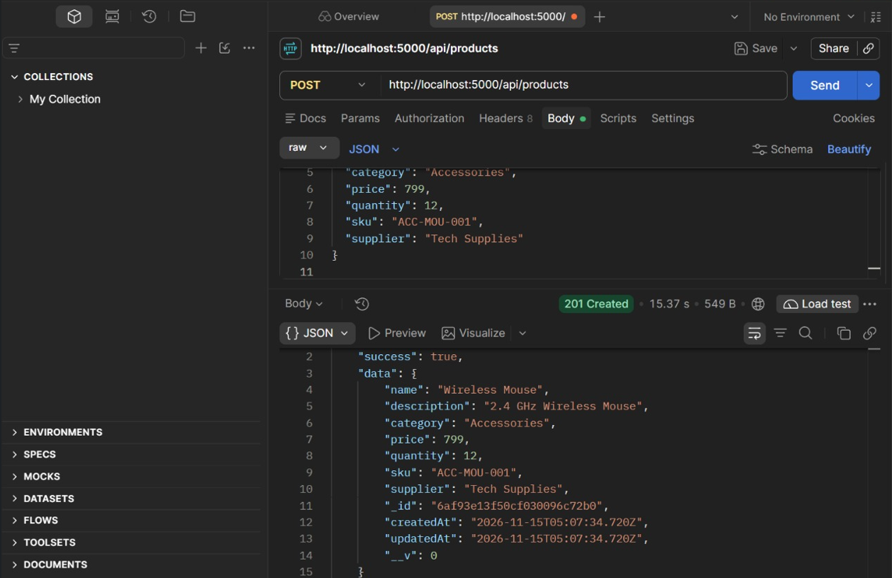
    </td>
    <td width="50%">
      <strong>02 · Get All Products</strong><br>
      
    </td>
  </tr>
  <tr>
    <td>
      <strong>03 · Get Product by ID</strong><br>
      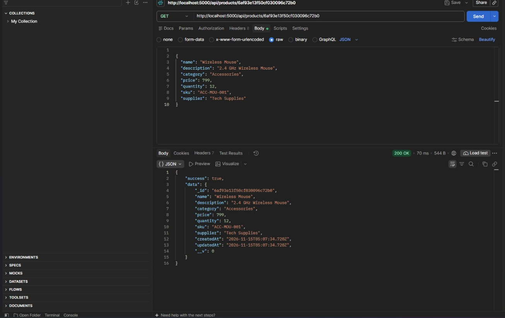
    </td>
    <td>
      <strong>04 · Update Product</strong><br>
      
    </td>
  </tr>
  <tr>
    <td>
      <strong>05 · Restock Product</strong><br>
      
    </td>
    <td>
      <strong>06 · Record a Sale</strong><br>
      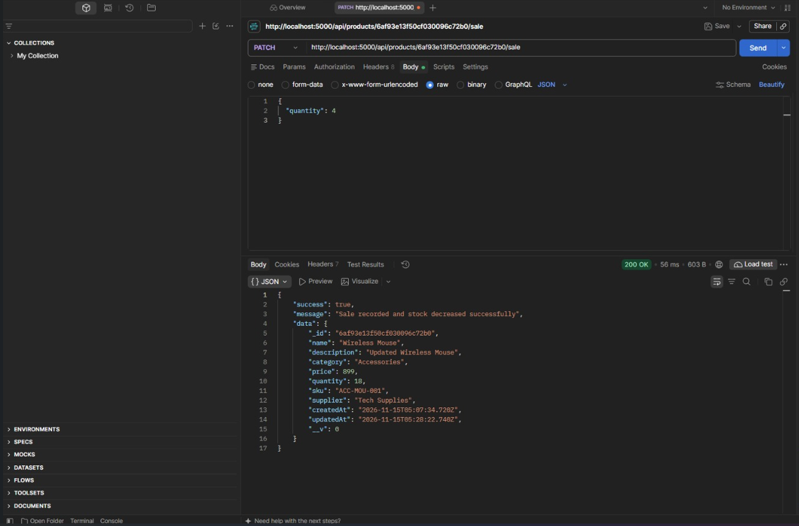
    </td>
  </tr>
  <tr>
    <td>
      <strong>07 · Delete Product</strong><br>
      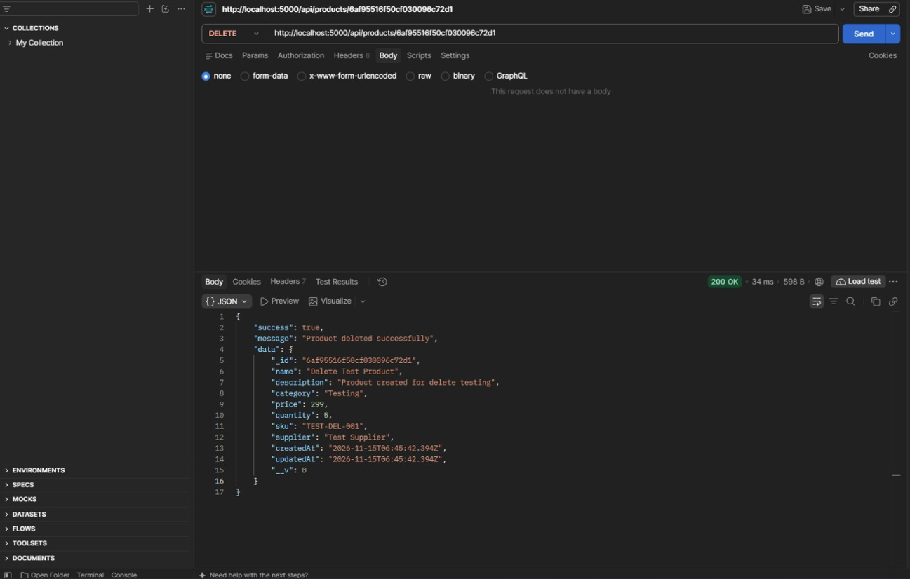
    </td>
    <td>
      <strong>08 · Low-Stock Report</strong><br>
      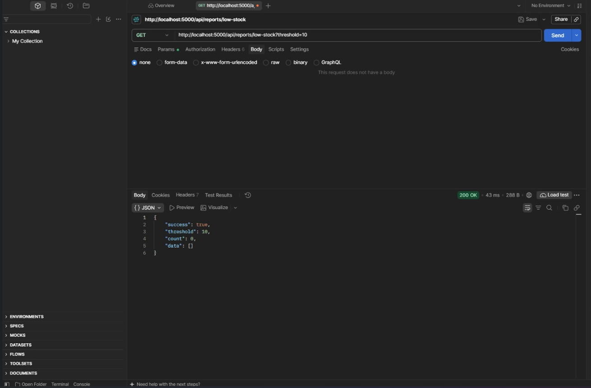
    </td>
  </tr>
</table>

### Reports, Filters and Additional Tests

<table>
  <tr>
    <td width="50%">
      <strong>09 · Category Summary</strong><br>
      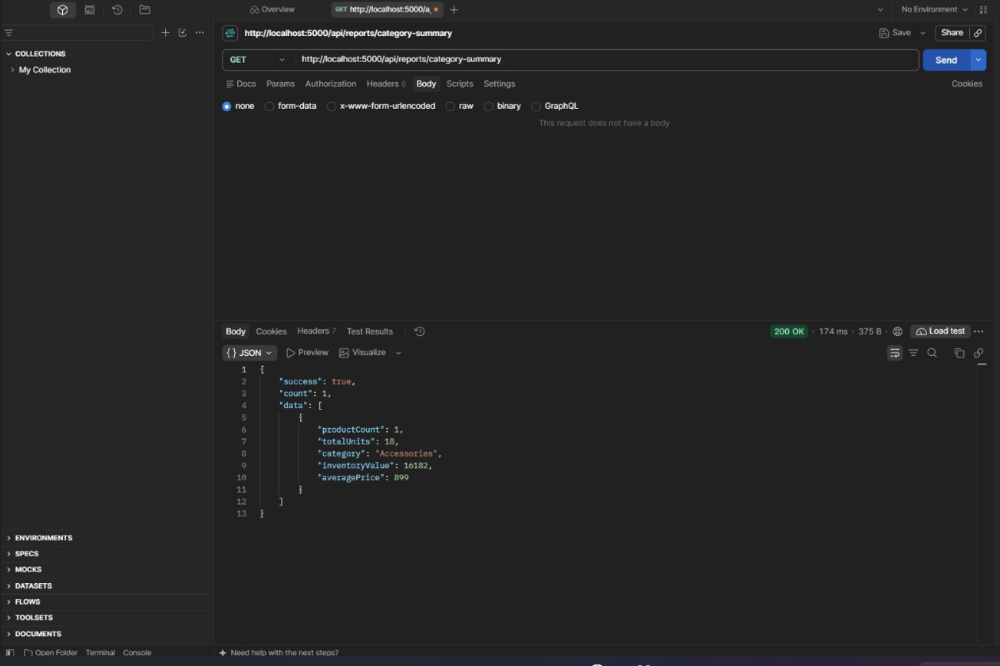
    </td>
    <td width="50%">
      <strong>10 · Category Filtering</strong><br>
      
    </td>
  </tr>
  <tr>
    <td>
      <strong>11 · Product Search</strong><br>
      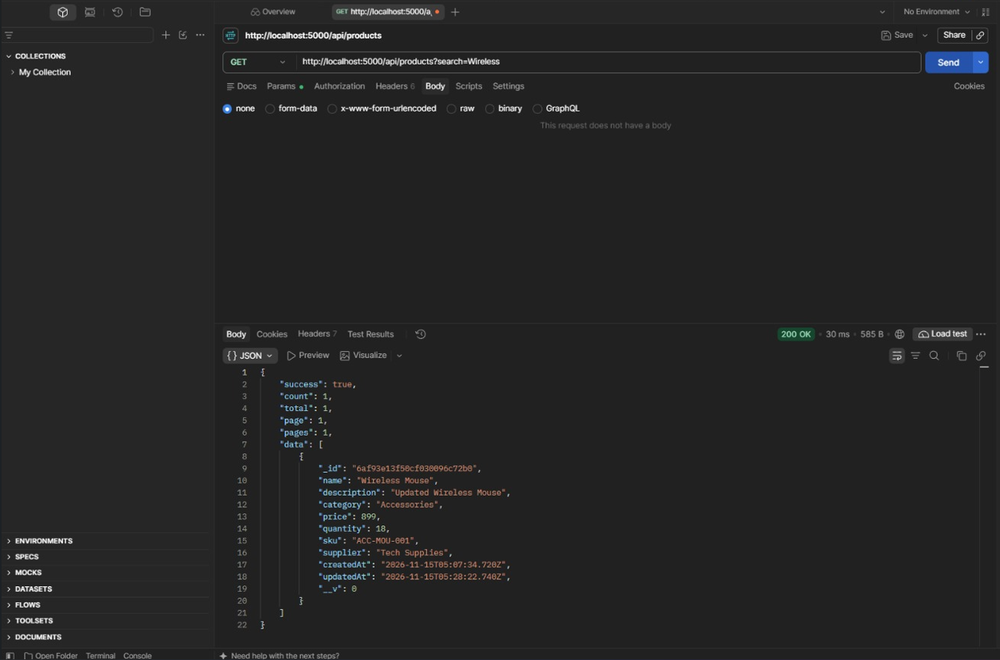
    </td>
    <td>
      <strong>12 · Price Filtering</strong><br>
      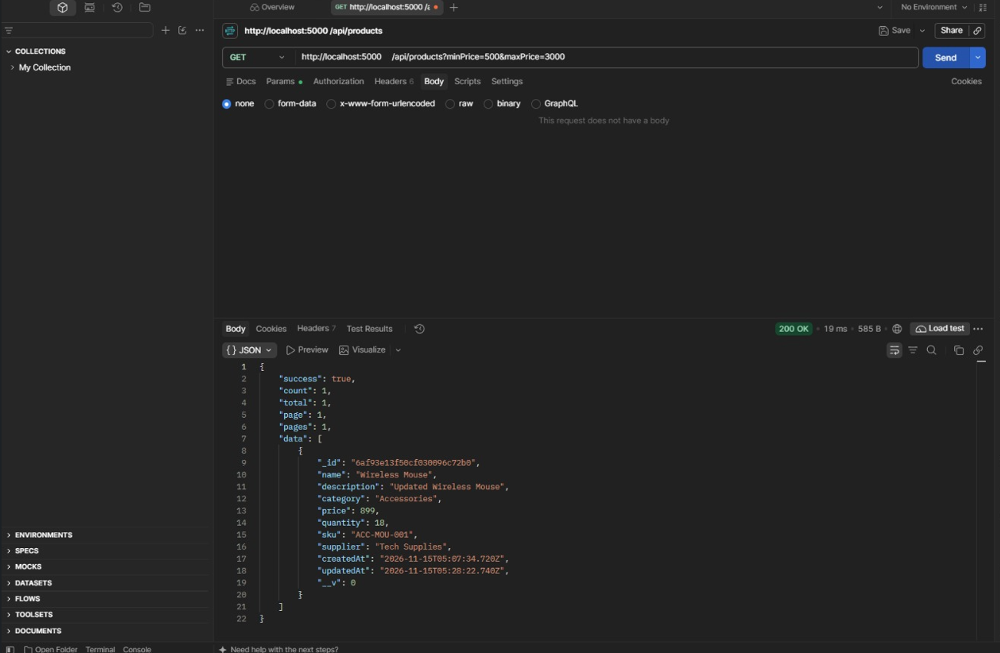
    </td>
  </tr>
  <tr>
    <td>
      <strong>13 · Sorting</strong><br>
      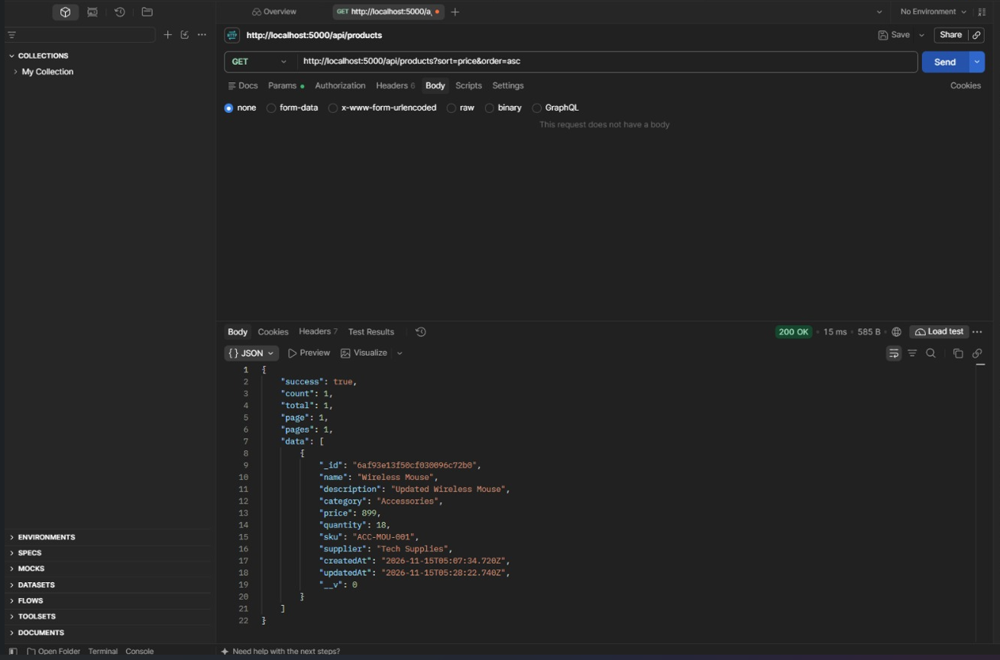
    </td>
    <td>
      <strong>14 · Pagination</strong><br>
      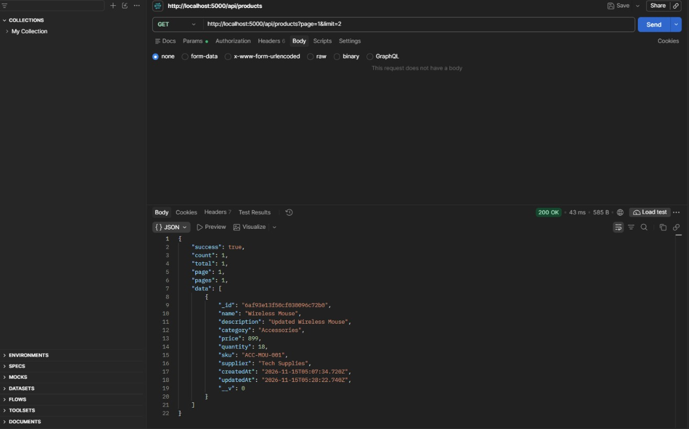
    </td>
  </tr>
  <tr>
    <td>
      <strong>15 · Product Validation</strong><br>
      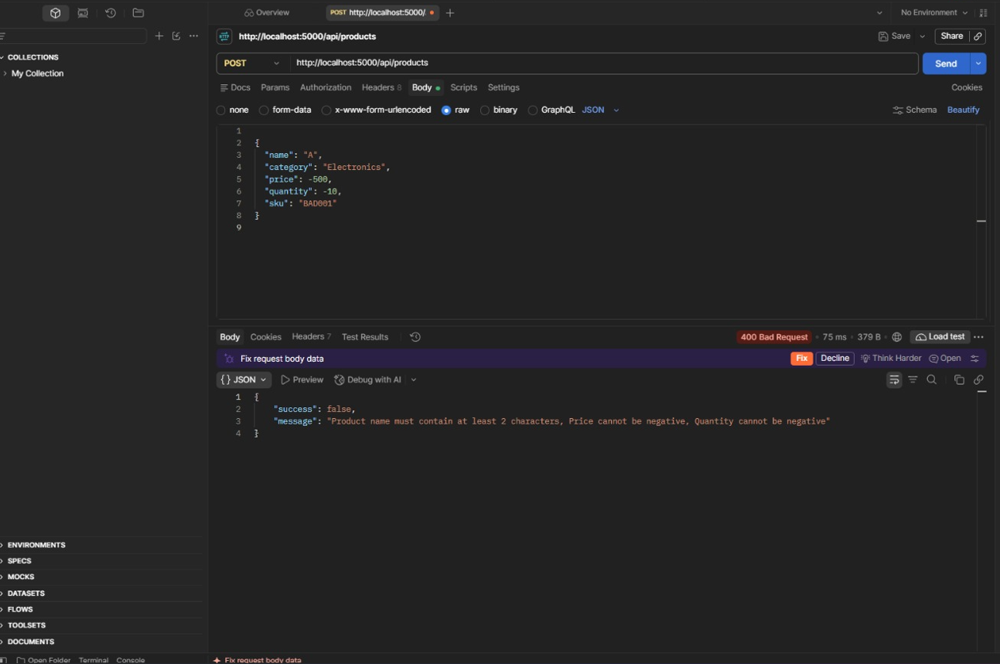
    </td>
    <td>
      <strong>16 · Duplicate SKU Validation</strong><br>
      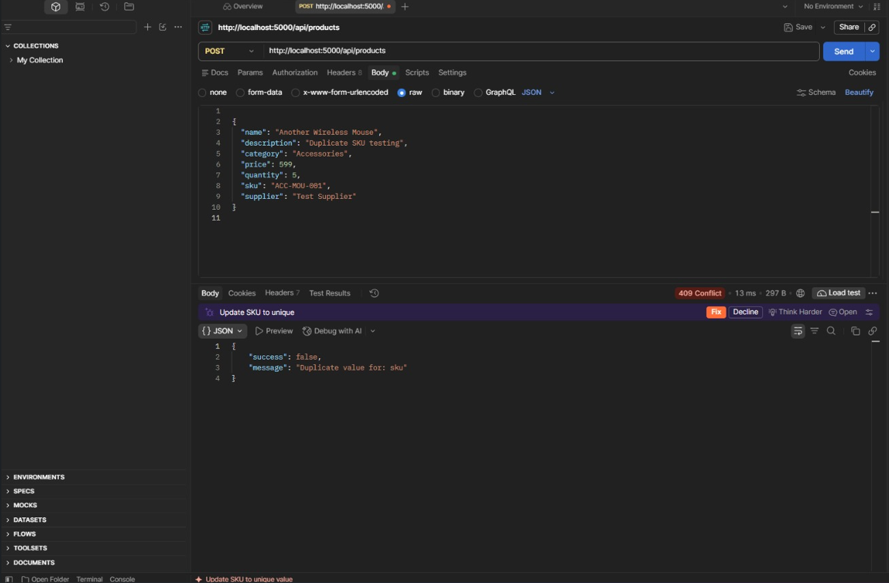
    </td>
  </tr>
</table>
                                                                                                                                                         
  ## 🔄 Testing Workflow                                                                                                                                                                                 
                                                                                                                                                                                                         
  1. Create multiple products and retrieve them.                                                                                                                                                         
  2. Test category filtering, product search, and price filtering.                                                                                                                                       
  3. Test sorting and pagination.                                                                                                                                                                        
  4. Retrieve a product by ID and update its details.                                                                                                                                                    
  5. Restock a product and record a sale.                                                                                                                                                                
  6. Test stock validation and delete a product.                                                                                                                                                         
  7. Generate the low-stock report and category-wise summary.                                                                                                                                            
  8. Test invalid product data and duplicate SKU validation.                                                                                                                                             
  ──────                                                                                                                                                                                                 
  ## 🛡 Error Handling                                                                                                                                                                                    
                                                                                                                                                                                                         
  • Schema-based product validation: Guards required fields and invalid value types.                                                                                                                     
  • Duplicate SKU handling: Catches MongoDB E11000 duplicate key constraint errors.                                                                                                                      
  • Invalid MongoDB ID handling: Safely catches CastError exceptions on malformed IDs.                                                                                                                   
  • Missing product handling: Returns standard 404 when records do not exist.                                                                                                                            
  • Missing route handling: Fallback route handler for unsupported URLs.                                                                                                                                 
  • Centralized error middleware: Delivers clean, uniform JSON error responses.                                                                                                                          
  ──────                                                                                                                                                                                                 
  ## 📝 Project Notes                                                                                                                                                                                    
                                                                                                                                                                                                         
  • This is a backend-only application; no frontend or admin panel is included.                                                                                                                          
  • MongoDB is used for persistent data storage.                                                                                                                                                         
  • Express.js manages API routes and middleware.                                                                                                                                                        
  • Mongoose manages product schemas and validation.                                                                                                                                                     
  • The application follows a modular backend architecture.                                                                                                                                              
  ──────                                                                                                                                                                                                 
  ## 👨‍​🎓 Submission Details                                                                                                                                                                             
                                                                                                                                                                                                         
   Field                                                                                             │ Value
  ───────────────────────────────────────────────────────────────────────────────────────────────────┼───────────────────────────────────────────────────────────────────────────────────────────────────
   Submitted by                                                                                      │ Mohit Sharma
   Roll number                                                                                       │ 2501010091
   Assignment                                                                                        │ Web Development III – Assignment 3
