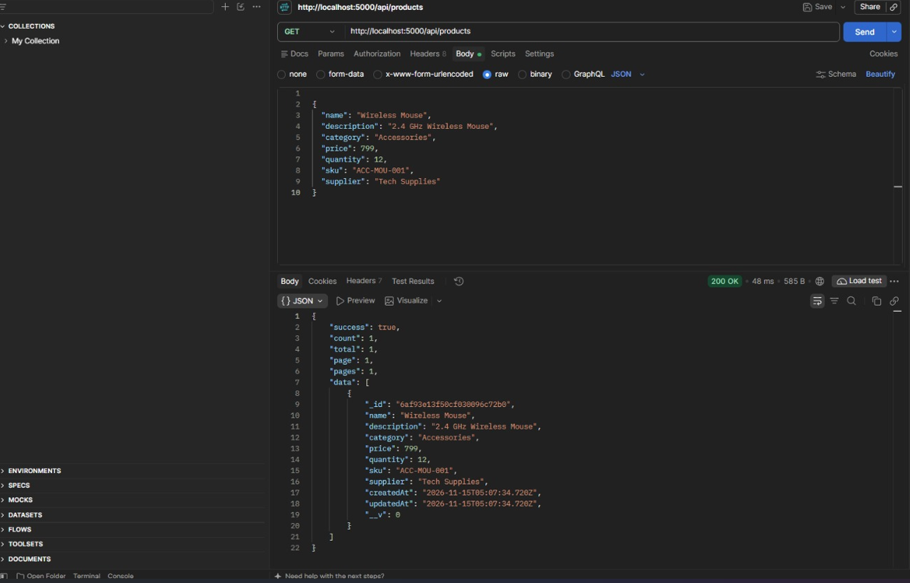
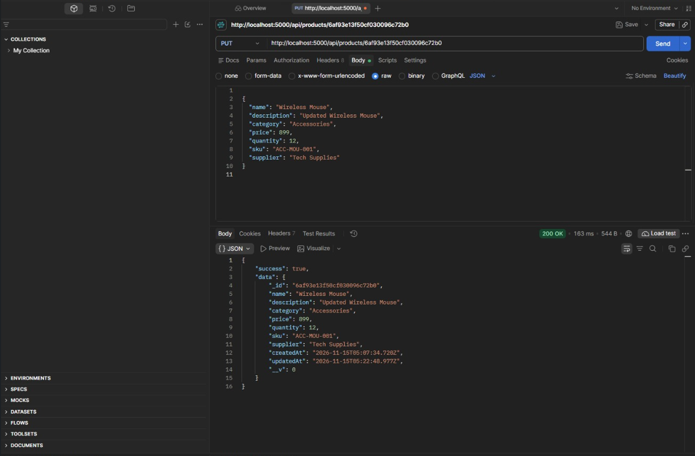
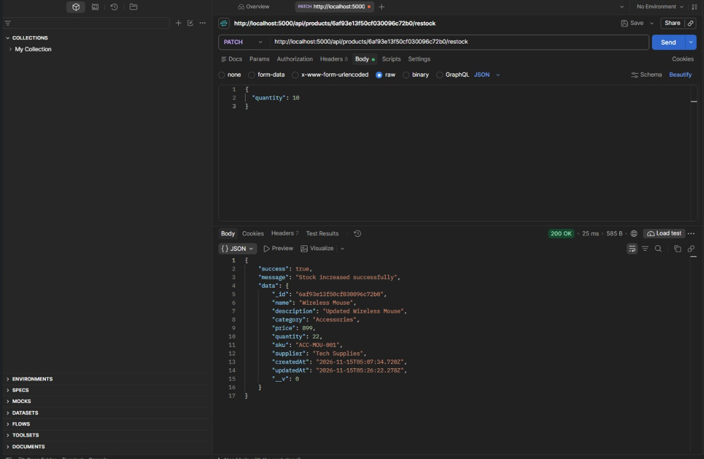
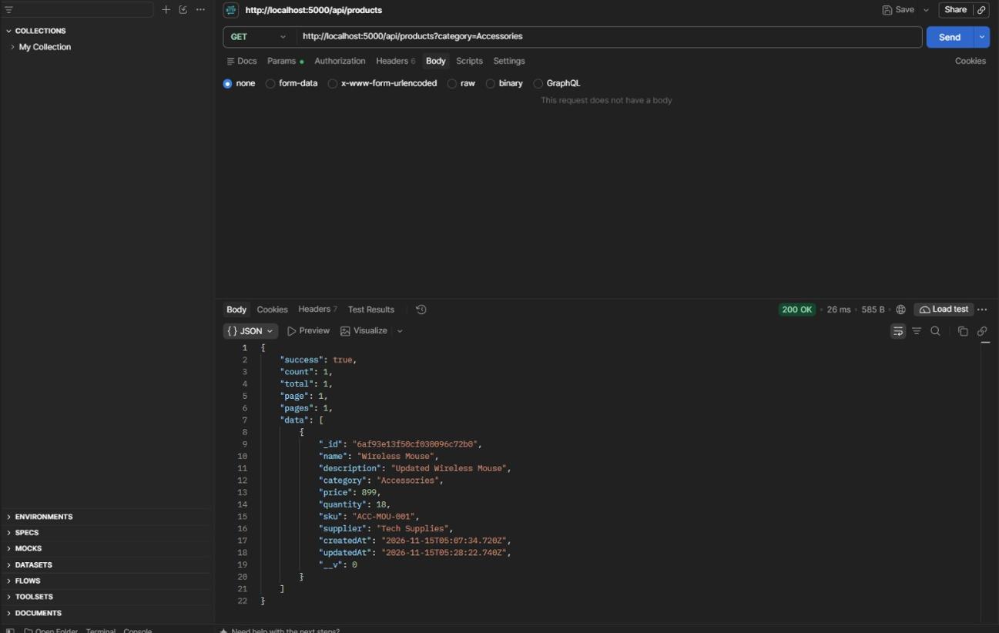

<div align="center">
Inventory Management System
A backend application for managing products, monitoring stock levels, processing stock changes, and generating inventory reports.

Built with Node.js · Express.js · MongoDB · Mongoose
</div>

---

## Overview

Developed for **Assignment 3 – Web Development III (Unit 3)**, this project provides APIs for product management, inventory tracking, stock operations, filtering, sorting, pagination, and inventory reports.

## Technology Stack

| Technology | Purpose |
|---|---|
| Node.js | JavaScript runtime |
| Express.js | Backend framework |
| MongoDB | NoSQL database |
| Mongoose | Database modeling and validation |
| dotenv | Environment variable management |
| Postman | API testing |

## Features

- Create, retrieve, update, and delete products
- Product schema validation and unique SKU validation
- Search products by name
- Filter products by category and price
- Sort product records and paginate results
- Restock products and record sales
- Prevent stock from becoming negative during sales
- Generate low-stock reports
- Generate category-wise inventory summaries
- Centralized error handling and JSON-based API responses

## Project Structure

```text
inventory-management-system/
├── config/
├── controllers/
├── middleware/
├── models/
├── routes/
├── screenshots/
├── .gitignore
├── package.json
├── package-lock.json
├── server.js
└── README.md
```

## Installation and Setup

### Prerequisites

- Node.js 18 or later
- MongoDB running locally or MongoDB Atlas
- npm

### 1. Clone the repository

```bash
git clone https://github.com/aradhana-bit/inventory-management-system.git
cd inventory-management-system
```

### 2. Install dependencies

```bash
npm install
```

### 3. Configure environment variables

Create a `.env` file in the project root:

```env
PORT=5000
MONGODB_URI=mongodb://127.0.0.1:27017/inventory_management
LOW_STOCK_THRESHOLD=5
```

For MongoDB Atlas, use your Atlas connection string as `MONGODB_URI`.

### 4. Start the development server

```bash
npm run dev
```

The API is available at:

```text
http://localhost:5000
```

## Product Schema

| Field | Description |
|---|---|
| `name` | Required string, 2–100 characters |
| `description` | Optional string, maximum 500 characters |
| `category` | Required string |
| `price` | Required number, minimum 0 |
| `quantity` | Required non-negative whole number |
| `sku` | Required unique string, stored uppercase |
| `supplier` | Optional string |
| `createdAt` | Automatically generated timestamp |
| `updatedAt` | Automatically generated timestamp |

## API Endpoints

### Product Management

| Method | Endpoint | Description |
|---|---|---|
| `POST` | `/api/products` | Create a product |
| `GET` | `/api/products` | Retrieve all products |
| `GET` | `/api/products/:id` | Retrieve a product by ID |
| `PUT` | `/api/products/:id` | Update product details |
| `DELETE` | `/api/products/:id` | Delete a product |
| `PATCH` | `/api/products/:id/restock` | Increase product stock |
| `PATCH` | `/api/products/:id/sale` | Record a sale and decrease stock |

### Inventory Reports

| Method | Endpoint | Description |
|---|---|---|
| `GET` | `/api/reports/low-stock` | Retrieve low-stock products |
| `GET` | `/api/reports/category-summary` | Generate category-wise inventory summary |

## API Request Examples

<details>
<summary><strong>1. Create a product</strong> — POST /api/products</summary>

```json
{
  "name": "Wireless Mouse",
  "description": "2.4 GHz wireless mouse",
  "category": "Accessories",
  "price": 799,
  "quantity": 12,
  "sku": "ACC-MOU-001",
  "supplier": "Tech Supplies"
}
```
</details>

<details>
<summary><strong>2. Update a product</strong> — PUT /api/products/PRODUCT_ID</summary>

```json
{
  "price": 849,
  "description": "Updated product description"
}
```
</details>

<details>
<summary><strong>3. Restock a product</strong> — PATCH /api/products/PRODUCT_ID/restock</summary>

```json
{
  "quantity": 10
}
```
</details>

<details>
<summary><strong>4. Record a sale</strong> — PATCH /api/products/PRODUCT_ID/sale</summary>

```json
{
  "quantity": 2
}
```

The sale operation uses a conditional database update to prevent stock from becoming negative.
</details>

### Other supported requests

| Operation | Request |
|---|---|
| Get all products | `GET /api/products` |
| Get product by ID | `GET /api/products/PRODUCT_ID` |
| Delete product | `DELETE /api/products/PRODUCT_ID` |
| Filter by category | `GET /api/products?category=Accessories` |
| Search by name | `GET /api/products?search=wireless` |
| Filter by price | `GET /api/products?minPrice=200&maxPrice=2000` |
| Sort by price | `GET /api/products?sort=price&order=asc` |
| Paginate results | `GET /api/products?page=1&limit=5` |
| Low-stock report | `GET /api/reports/low-stock?threshold=10` |
| Category summary | `GET /api/reports/category-summary` |

Allowed sort fields: `name`, `price`, `quantity`, `category`, `createdAt`.

Allowed order values: `asc`, `desc`.

The default low-stock threshold is configured through `LOW_STOCK_THRESHOLD`, or `5` if not configured. The category summary returns the product count, total available units, total inventory value, and average product price.

## Postman API Testing

The API was tested using Postman. The screenshots below show the requests and responses for the main operations and test cases.

### Product Management

<table>
  <tr>
    <td width="50%">
      <strong>01 · Create Product</strong><br>
      
    </td>
    <td width="50%">
      <strong>02 · Get All Products</strong><br>
      
    </td>
  </tr>
  <tr>
    <td>
      <strong>03 · Get Product by ID</strong><br>
      
    </td>
    <td>
      <strong>04 · Update Product</strong><br>
      
    </td>
  </tr>
  <tr>
    <td>
      <strong>05 · Restock Product</strong><br>
      
    </td>
    <td>
      <strong>06 · Record a Sale</strong><br>
      
    </td>
  </tr>
  <tr>
    <td>
      <strong>07 · Delete Product</strong><br>
      
    </td>
    <td>
      <strong>08 · Low-Stock Report</strong><br>
      
    </td>
  </tr>
</table>

### Reports, Filters and Additional Tests

<table>
  <tr>
    <td width="50%">
      <strong>09 · Category Summary</strong><br>
      
    </td>
    <td width="50%">
      <strong>10 · Category Filtering</strong><br>
      
    </td>
  </tr>
  <tr>
    <td>
      <strong>11 · Product Search</strong><br>
      
    </td>
    <td>
      <strong>12 · Price Filtering</strong><br>
      
    </td>
  </tr>
  <tr>
    <td>
      <strong>13 · Sorting</strong><br>
      
    </td>
    <td>
      <strong>14 · Pagination</strong><br>
      
    </td>
  </tr>
  <tr>
    <td>
      <strong>15 · Product Validation</strong><br>
      
    </td>
    <td>
      <strong>16 · Duplicate SKU Validation</strong><br>
      
    </td>
  </tr>
</table>

## Testing Workflow

1. Create multiple products and retrieve them.
2. Test category filtering, product search, and price filtering.
3. Test sorting and pagination.
4. Retrieve a product by ID and update its details.
5. Restock a product and record a sale.
6. Test stock validation and delete a product.
7. Generate the low-stock report and category-wise summary.
8. Test invalid product data and duplicate SKU validation.

## Error Handling

- Schema-based product validation
- Duplicate SKU handling
- Invalid MongoDB ID handling
- Missing product handling
- Missing route handling
- Centralized error middleware
- JSON error responses

## Project Notes

- This is a backend-only application; no frontend or admin panel is included.
- MongoDB is used for persistent data storage.
- Express.js manages API routes and middleware.
- Mongoose manages product schemas and validation.
- The application follows a modular backend architecture.

---

## Submission Details

| | |
|---|---|
| **Submitted by** | mohit sharma |
| **Roll number** | 2501010091 |
| **Assignment** | Web Development III – Assignment 3 |
